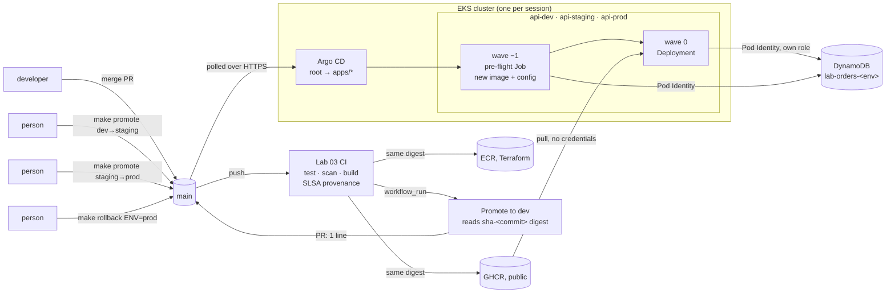

# Capstone C: the delivery platform

One merge to `main`, traced through build, provenance, registry, reconciliation, three promotions and a rollback, with no digest typed by anyone. Then a deliberately bad prod deploy, which the platform turned away without anyone watching, and the bug it exposed. On EKS, one session, about $0.30.

The runbook for the team that inherits this is [RUNBOOK.md](RUNBOOK.md).

| Path | What |
|---|---|
| [`deploy/envs/{dev,staging,prod}`](../deploy/envs) | what each environment runs: one digest each |
| [`deploy/apps/`](../deploy/apps) | an Application per environment, in the AppProject `api` |
| [`k8s/overlays/eks/preflight.yaml`](../k8s/overlays/eks/preflight.yaml) | the gate before traffic: the new image and config, tested in the cluster |
| [`infra/eks/identity.tf`](../infra/eks/identity.tf) | a table and a role per environment |
| [`scripts/promote.sh`](../scripts/promote.sh), [`rollback.sh`](../scripts/rollback.sh), [`where.sh`](../scripts/where.sh) | `make promote`, `make rollback`, `make where` |
| [`.github/workflows/promote-dev.yml`](../.github/workflows/promote-dev.yml) | CI's last step: the dev promotion pull request |

Run on EKS 1.35, 2 × `t3.small`, Argo CD v3.5.6, October 2026.

---

## The result

| Deliverable | Result |
|---|---|
| A single merge, traced end to end with timestamps | #74 (`48fc0a4`) merged at 00:23:56. CI built, attested and published it by 00:26:08; dev ran it at 00:42:36, staging at 00:57:19, prod at 01:02:55. Every handoff below. |
| A deliberately bad deploy that rolls itself back without human action | A prod change to a table that does not exist (#80) was **turned away by the pre-flight hook**: the Deployment never changed, and prod served **6,887 of 6,887** requests through it and the rest of the session. Nothing rolled forward, so nothing had to roll back. Git still declared the bad change until `make rollback` reverted it (#82). |
| A one-page runbook | [RUNBOOK.md](RUNBOOK.md) |
| An architecture diagram | below |

| Roadmap "what you build" | Result |
|---|---|
| A signed, attested image | `gh attestation verify`: SLSA provenance v1, signed through Sigstore by `reusable-service-ci.yml@refs/heads/main`, source commit `48fc0a4`, trigger `push` |
| Terraform-managed ECR holding it | `ci-cd-lab/api:sha-48fc0a4…` in ECR is `sha256:44e43e95…`, the digest the cluster runs from GHCR |
| Argo CD reconciling dev from a pinned digest | #75, opened by CI, merged; Argo CD synced dev 4m27s later |
| Promotion to staging and prod, each a one-line change | #76 and #78, `+1 −1` each, opened by `make promote` |
| Smoke tests as sync hooks | the pre-flight Job, wave −1, in every environment and every sync |
| A deployment dashboard | `make where`, from Git, GHCR and the cluster; nothing maintained by hand |
| A cold-start path in one command | `make platform-up`: no cluster to three Synced/Healthy environments in **12m 51s** |

---

## The delivery path



Nothing points from GitHub into the cluster. CI writes to Git and to registries; the cluster reads from both.

---

## One merge, traced

| Time (UTC) | Stage | Evidence |
|---|---|---|
| 00:23:56 | #74 merged to `main` as `48fc0a4` | |
| 00:23:58 → 00:26:08 | Lab 03 CI: tests, vulnerability scan, image build, provenance, push to GHCR and ECR | `sha-48fc0a4…` = `sha256:44e43e95…` in both |
| 00:26:10 | Promote to dev starts; closes the superseded #71 and #73 | |
| 00:26:27 | #75 opened: `deploy/envs/dev` → `sha256:44e43e95…` | digest read from GHCR by tag, not typed |
| 00:37:35 | #75's held checks approved (one click, made through the API) | see [GITOPS.md](GITOPS.md) for why |
| 00:37:57 | #75 merged by auto-merge | |
| 00:42:24 → 00:42:36 | Argo CD syncs dev; pre-flight passes, reporting `git_sha 48fc0a4…`, `environment dev` | |
| 00:53:34 | `make promote FROM=dev TO=staging` opens #76 | the 11-minute gap before it is a scripting mistake of mine, not the platform |
| 00:54:07 → 00:57:19 | #76 merged; staging serves the new digest | |
| 00:57:33 | `make promote FROM=staging TO=prod` opens #78 | |
| 00:58:06 → 01:02:55 | #78 merged; prod serves the new digest | pre-flight in prod: `environment prod`, order round trip |

The cluster itself was cold-started in parallel, from 00:24:15 to 00:37:06; the approval was held until it was up, so the dev rollout could be watched.

The digest crossed four handoffs: CI's build output → the GHCR tag `sha-<commit>` → dev's file (CI) → staging's file → prod's file (`make promote`, which reads the previous environment's file). Each promotion's pull request names the commit the digest was built from, which `scripts/image-commit.sh` reads from the image's own config on GHCR.

`make where` afterwards:

```
| env     | declared digest      | built from | set by (on main)                      | running                       | Argo CD                             |
| dev     | sha256:44e43e951bcb  | 48fc0a4    | ab45f3c Promote 48fc0a4 to dev (#75)     | sha256:44e43e951bcb (matches) | Synced/Healthy, last sync Succeeded |
| staging | sha256:44e43e951bcb  | 48fc0a4    | 19853e8 Promote 48fc0a4 to staging (#76) | sha256:44e43e951bcb (matches) | Synced/Healthy, last sync Succeeded |
| prod    | sha256:44e43e951bcb  | 48fc0a4    | 8bb063c Revert "prod: rename the orders table again …" (#88) | sha256:44e43e951bcb (matches) | Synced/Healthy, last sync Succeeded |
```

---

## A bad deploy, turned away before traffic

**Test the new release where it will run, before it takes traffic, and stop the sync if it fails.** The pre-flight Job runs in wave −1 with the new digest and the new ConfigMap. It checks the table, starts the app inside the Job, checks `/version` and writes and reads an order. Wave 0, the Deployment, only applies if it passed.

#80 set prod's `ORDERS_TABLE` to `lab-orders-prd`. Merged at 01:04:01:

```
PREFLIGHT FAILED: table lab-orders-prd: An error occurred (AccessDeniedException) when calling the
DescribeTable operation: User: …assumed-role/lab-api-prod/… is not authorized to perform:
dynamodb:DescribeTable on resource: …table/lab-orders-prd

phase=Failed  01:06:26 → 01:12:30  "one or more synchronization tasks completed unsuccessfully (retried 5 times)"
sync=OutOfSync  health=Healthy
deployment: image @sha256:44e43e95… (unchanged), 2/2 ready
```

`AccessDenied`, not "not found": the prod role may only touch `lab-orders-prod`. A pod in `api-prod` sending orders through the Service the whole time saw no failures: 6,887 of 6,887 by the end of the session, all served by `48fc0a4`.

**Then the bug.** The sync had stopped at wave −1, but Argo CD had already **pruned** `api-config-54c4hmt4k5`, the ConfigMap the running prod pods referenced (controller log: `status: 'Pruned' … api-config-54c4hmt4k5`). Running pods do not notice; they read their environment at start. A prod pod deleted to test it:

```
api-6d9889dbd-f7bs4   0/1   CreateContainerConfigError
Error: configmap "api-config-54c4hmt4k5" not found
```

Prod was down to one pod until the rollback. The release the gate rejected had still damaged prod, on a delay. Fixed by `PruneLast=true` on the api Applications (#84), which prunes only after every wave has succeeded. The same bad change repeated (#86): the sync failed the same way, `api-config-54c4hmt4k5` survived, and a deleted prod pod came back `Running` in 7 seconds. After the rollback's successful sync, the rejected release's ConfigMap was pruned, as intended.

| | How it happens | What goes wrong | What you see |
|---|---|---|---|
| **Prune before the gate** | `prune: true` without `PruneLast=true` | a failed sync deletes objects the running version needs | `OutOfSync`, `Healthy`; then a restarted pod in `CreateContainerConfigError` hours later |
| **Gate after traffic** | smoke test as a `PostSync` hook | the new pods already serve when it fails, and Argo CD does not roll back | users see the bad version; the sync is marked failed afterwards |
| **Rollback in the cluster** | `kubectl rollout undo` | self-heal reapplies Git | the undo is gone within a second (below) |

What this gate cannot catch: a release that passes every check in the Job and fails under real traffic. Rolling back after traffic needs a controller that watches metrics, which is Project 15.

---

## Rollback is a Git operation

**Revert the change in Git; never undo it in the cluster.** `make rollback ENV=prod` reverts the last commit that touched `deploy/envs/prod`, as a pull request, and refuses one that changed other files too. #82 merged at 01:13:53; prod had its ConfigMap back and 2 of 2 pods ready at 01:15:09.

`kubectl rollout undo` instead, on healthy prod:

```
REVISION 3   ReplicaSet api-5fb4bc8474 (the previous image) scaled 0 → 1    ← the undo
REVISION 4   ReplicaSet api-5fb4bc8474 scaled 1 → 0, a second later        ← self-heal
```

Argo CD put prod back to what Git says before the old version could take over. An operator who "rolled back" this way would see their rollback vanish.

---

## Three environments, one cluster: the honest limits

What is separate: each environment has its own namespace, ServiceAccount, Pod Identity role and DynamoDB table. A dev pod reading the prod table:

```
AccessDeniedException … User: arn:aws:sts::…:assumed-role/lab-api-dev/… GetItem on lab-orders-prod
```

The AppProject `api` limits the api Applications to this repository, the `api-*` namespaces and six object kinds.

What is shared, and would not be in production: the nodes, so a busy dev competes with prod for CPU and memory; the control plane and one Argo CD, so an upgrade or an outage of either hits all three; no NetworkPolicy, so a dev pod can call the prod Service. Real separation is a cluster (or an account) per environment, which here would triple the bill.

Terraform and Argo CD do not overlap. Terraform owns everything in AWS: the cluster, the tables, the roles and the Pod Identity associations. Argo CD owns everything in the cluster, including the namespaces. The only thing both mention is a namespace's name, as a string on the AWS side.

---

## Cold start

`make platform-up` from an account with no cluster: `eks-up` (31 resources), `argocd-bootstrap`, then a wait until every Application is Synced and Healthy, then `make where`. **00:24:15 → 00:37:06, 12m 51s.** Every environment's pre-flight passed on its own table in that first sync. Project 14's rebuild drill showed the same from a destroyed cluster.

---

## What went wrong while building this

- **A rejected release still pruned the ConfigMap prod was running on.** Found by the deliberately bad deploy, proved by deleting a pod, fixed with `PruneLast=true`, and the fix proved by repeating the deploy.
- **The pre-flight's first version would have failed off EKS**: `boto3.client("dynamodb")` reads `AWS_DEFAULT_REGION`, which only Pod Identity happened to set. Found by testing the Job's script against DynamoDB Local before the session; it now passes `region_name`.
- **zsh, three more times.** `$E` holding several `-e` flags was passed as one argument (the local pre-flight test), `set -- $pair` did not split (the promotion loop, which then polled `gh pr view` with no PR number for 10 minutes), and the trace has an 11-minute gap because of it.
- **The dev promotion still needs one approval click**, as in Project 14.
- **The deliberately bad deploys and their reverts are four commits on `main`** (#80, #82, #86, #88). They are the record of the test, and `git log -- deploy/envs/prod` shows them.
